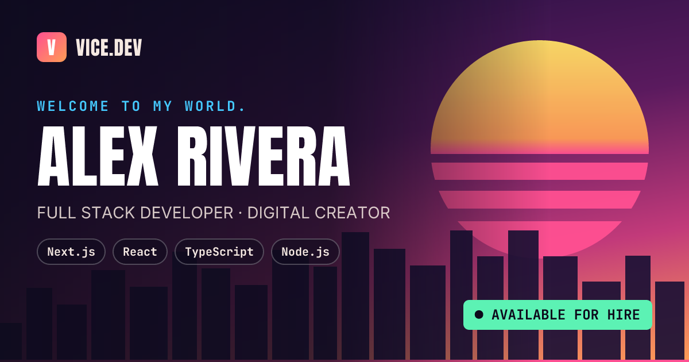

# SEO and social previews

Everything below works out of the box. You only need to fill in a few values in `src/config/site.ts` and set your domain.



## What's included

| | What | Where |
|---|---|---|
| 🖼️ | **Social preview images** (1200×630 PNG) for link previews on X, LinkedIn, Slack, Discord, WhatsApp, iMessage… | `src/app/opengraph-image.tsx` (site), `projects/[slug]/opengraph-image.tsx`, `blog/[slug]/opengraph-image.tsx` |
| 🏷️ | **Titles and descriptions** per page, with `Page · VICE.DEV` title template | `src/lib/seo.ts` → `pageMetadata()` |
| 🔗 | **Canonical URLs** on every indexable page | `pageMetadata()` |
| 📣 | **Open Graph + X (Twitter) cards**: `summary_large_image`, locale, article dates, `twitter:creator` | `pageMetadata()` |
| 🧩 | **Structured data (JSON-LD)**: `Person` + `WebSite` on the homepage, `CreativeWork` per project, `BlogPosting` per post, `BreadcrumbList` on detail pages | `src/lib/seo.ts`, `src/components/seo/JsonLd.tsx` |
| 🗺️ | **sitemap.xml** with all projects and posts | `src/app/sitemap.ts` |
| 🤖 | **robots.txt**: blocks `/admin`, `/api`, `/hideout`; blocks *everything* on preview deployments | `src/app/robots.ts` |
| 📰 | **RSS feed** at `/rss.xml`, linked from every page's `<head>` | `src/app/rss.xml/route.ts` |
| 📱 | **Web app manifest**, SVG favicon, Apple touch icon | `src/app/manifest.ts`, `icon.svg`, `apple-icon.tsx` |
| ✅ | **Search Console / Bing verification** via env vars | `src/app/layout.tsx` |
| 🚫 | `noindex` on admin, the secret hideout, missing pages, and non-production builds | |

## Setup checklist

1. **Edit `seo` in `src/config/site.ts`:**
   ```ts
   seo: {
     title: "Your Name — Full Stack Developer",   // homepage <title>, keep under ~60 chars
     description: "…",                              // ~150 chars, shown in Google results
     keywords: ["Your Name", "full stack developer", …],
     locale: "en_US",
     twitterHandle: "@you",                          // or "" to omit
     jobTitle: "Full Stack Developer",               // used in structured data
     knowsAbout: ["Next.js", "React", …],            // first 4 also appear on the social card
   }
   ```
   Also set `player.avatar` if you have a photo. It becomes the `Person` image in structured data.

2. **Set your domain.** Use `NEXT_PUBLIC_SITE_URL=https://yourdomain.com` in production.
   On Vercel it falls back to your production domain automatically, but setting it is recommended once you have a custom domain. Canonical URLs, social images, sitemap and RSS all use this value.

3. **Verify ownership** (optional, recommended):
   - Google Search Console → Add property → *HTML tag* → copy the `content` value → `GOOGLE_SITE_VERIFICATION`.
   - Bing Webmaster Tools → *Meta tag* → `BING_SITE_VERIFICATION`.
   - Redeploy, verify, then submit `https://yourdomain.com/sitemap.xml`.

4. **Set the GitHub repository preview** (for the template repo itself): on GitHub go to **Settings → General → Social preview → Edit**, then upload [`docs/media/social-preview.png`](media/social-preview.png).

## Social preview images

All cards share one renderer, `src/lib/og.tsx`:

- **Site card:** your name, tagline, role, top skills and an "Available for hire" badge (when `player.available` is true).
- **Mission card:** project title, year, difficulty, summary, tech stack, XP badge in the project's accent color.
- **News card:** post title, tag, excerpt, publish date.

They're generated at build time with `next/og` and use the site's fonts (Anton, Inter, JetBrains Mono). The fonts are fetched from Google Fonts during the build; if that fails (offline build), the cards still render with a fallback font. The domain is printed on the card once `NEXT_PUBLIC_SITE_URL` points somewhere other than localhost.

**Restyle all cards:** edit the JSX in `renderOgImage()` (Flexbox only: `next/og` uses Satori, which supports a subset of CSS).
**Add a card to another page:** create `opengraph-image.tsx` in that route folder and call `renderOgImage({ kicker, title, subtitle, chips, badge, accent })`. Then pass `hasOwnImage: true` to that page's `pageMetadata()`.

> Why `hasOwnImage`? Next.js merges metadata shallowly. When a page sets its own `openGraph` object, the root image would be lost, so `pageMetadata()` re-adds the default image unless the page has its own.

**Testing previews:**

- Locally: open `http://localhost:3000/opengraph-image`, or the image URL from a page's `og:image` tag.
- After deploying: [opengraph.xyz](https://www.opengraph.xyz), [LinkedIn Post Inspector](https://www.linkedin.com/post-inspector/) (it also refreshes LinkedIn's cache) or [metatags.io](https://metatags.io).
- Structured data: [Google Rich Results Test](https://search.google.com/test/rich-results) and [Schema Markup Validator](https://validator.schema.org).

## Adding a new page

```ts
// src/app/(site)/uses/page.tsx
import type { Metadata } from "next";
import { pageMetadata } from "@/lib/seo";

export const metadata: Metadata = pageMetadata({
  title: "Uses",
  description: "The hardware and software I use every day.",
  path: "/uses",
});
```

Then add it to `src/app/sitemap.ts`.

## Things that are deliberately not done

- **No keyword stuffing or hidden text.** Content quality and the page title/description matter far more.
- **No `hreflang`.** Add `alternates.languages` in `pageMetadata()` if you translate the site.
- **Client-side game features are invisible to crawlers**, which is fine: all real content (bio, projects, posts, experience) is server-rendered HTML.
